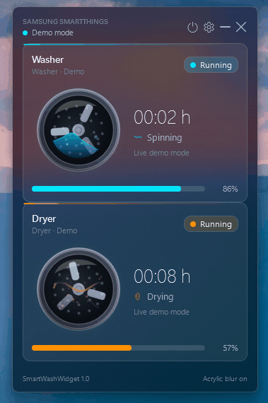
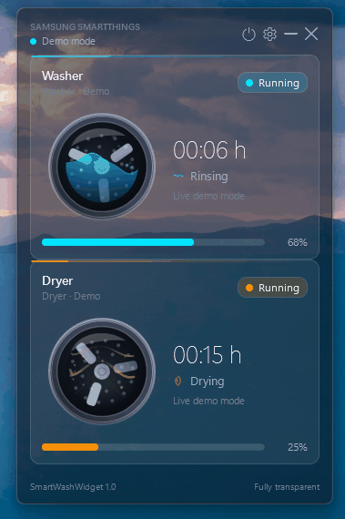
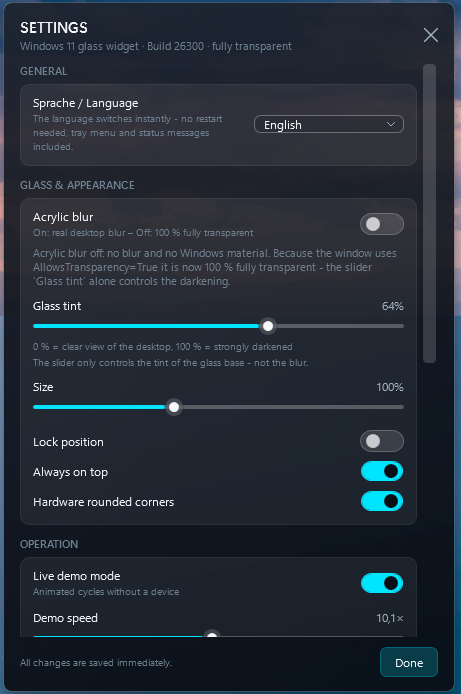
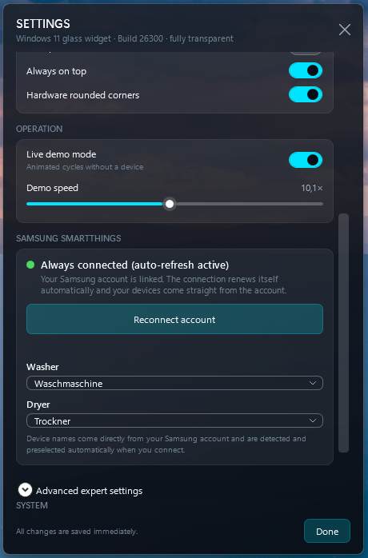
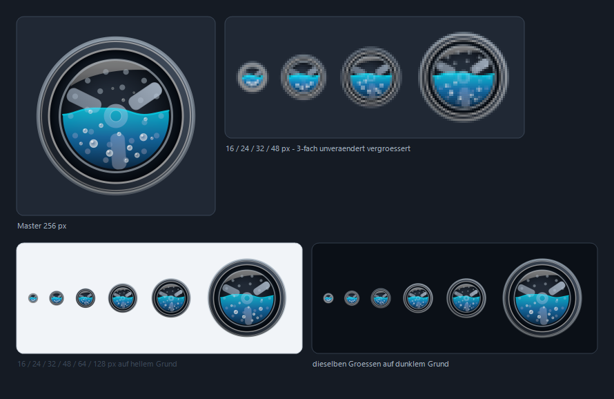

# SmartWashWidget

[](https://github.com/jsabrautzky-oss/SmartWashWidget/actions/workflows/build.yml)


A **Windows 11** desktop widget in a glassmorphism / Fluent Acrylic look that watches **your Samsung washer and dryer through the SmartThings API**: rotating drums with a water wave or with heat waves, a glowing progress bar with a percentage, remaining time and the current phase — live, from the tray, with no window in the taskbar (a switch in the settings can show one).

Connecting is **one click**: the widget fetches the official SmartThings CLI, opens the normal Samsung sign-in in your browser, and from then on keeps the access token valid entirely on its own — no personal access token to create, paste and renew. Built with C#/.NET 9 (WPF), **without a single NuGet package** (BCL only: `HttpClient`, `System.Text.Json`, GDI+ for the tray icon). All graphics and animations are drawn in code.

Ready-to-run builds on the **[latest release](https://github.com/jsabrautzky-oss/SmartWashWidget/releases/latest)** — both are the same self-contained win-x64 single-file EXE, so neither needs an installed .NET:

* **`SmartWashWidget-Setup-1.1.2.exe`** — Inno Setup installer: Start Menu entry, optional desktop shortcut, optional "start with Windows" task
* **`SmartWashWidget-Portable-1.1.2-win-x64.zip`** — portable version: unpack anywhere and start `SmartWashWidget.exe`, no installation and no administrator rights

---

## Preview

Washer (water wave + beads) and dryer (heat waves + warm particles), both while a cycle is running:

| Washer | Dryer |
|---|---|
|  |  |

The settings window — language and glass & appearance at the top, Samsung connection and device assignment at the bottom:

| Glass & appearance | Samsung SmartThings access |
|---|---|
|  |  |

Without a stored token the widget starts immediately in **demo mode** with animated simulated cycles — the previews above were recorded exactly that way.

---

## Contents

* [Preview](#preview)
* [Features](#features)
* [One-click connection to Samsung](#one-click-connection-to-samsung)
* [Token validity through the SmartThings CLI](#token-validity-through-the-smartthings-cli)
* [Quick start](#quick-start)
* [Manual access with a personal access token](#manual-access-with-a-personal-access-token)
* [Build, publish, installer and portable version](#build-publish-installer-and-portable-version)
* [Application icon](#application-icon)
* [Controls](#controls)
* [Command-line arguments](#command-line-arguments)
* [Configuration file](#configuration-file)
* [How the glass look works](#how-the-glass-look-works)
* [Troubleshooting](#troubleshooting)
* [Known limitations](#known-limitations)
* [Data storage and privacy](#data-storage-and-privacy)
* [Project structure](#project-structure)
* [License](#license)

---

## Features

| Area | Details |
|---|---|
| **One-click Samsung connection** | One click on **Connect with Samsung SmartThings now**: official Samsung sign-in in your browser, washer and dryer found and preselected automatically — no OAuth client ID, no client secret, no app registration, no token to paste |
| **Token that stays valid** | Automatic renewal through the official SmartThings CLI: a check before every request (10-minute margin), one refresh-and-retry on HTTP 401, and an hourly background check that renews 12 hours ahead |
| **Real data** | `GET /v1/devices` and `GET /v1/devices/{id}/status` with a bearer token, fault-tolerant JSON parsing (including `samsungce.*` and `custom.*` capabilities) |
| **Automatic device discovery** | Washer and dryer are recognised through their capabilities and assigned automatically; when several candidates match, the drop-downs in the settings window pick the right one |
| **States** | `Running`, `Paused`, `Finished`, `Ready` (standby glow), `Offline` — and `Connection lost` in the header when the access itself fails |
| **Progress** | Remaining time from `remainingTime` / `remainingTimeStr` / `completionTime`, the machine's reported `progress`, and the phase name (pre-wash, washing, rinsing, spinning, drying, cooling down) |
| **Animations (throttled frame loop)** | Drum with paddles, water wave + beads while washing, heat bands + warm particles while drying, glowing progress bar with percentage. The loop is capped at 20 FPS while a machine works, runs at 10 FPS for pure logic ticks and detaches completely when both machines stand still: nothing is repainted, the acrylic backdrop is not recomputed, and measured 3D GPU load in idle is ~0 % |
| **Tray icon** | Drawn programmatically, recoloured by connection state, menu with show/hide, live demo mode, acrylic blur, settings, exit |
| **Settings window** | Samsung connection and device assignment, acrylic blur on/off, glass tint 0–100 % (default 0 %), size 70–150 %, lock position, always on top, hardware rounded corners, demo speed, interface language, **start with Windows on/off**, **show in the taskbar on/off**, **update check on/off** |
| **Start with Windows** | The switch writes (or removes) the value `"SmartWashWidget"` under `HKEY_CURRENT_USER\Software\Microsoft\Windows\CurrentVersion\Run` — current user only, no administrator rights, no scheduled task. The registry is the single source of truth, so an autostart added by hand stays visible in the settings |
| **Taskbar switch** | Default is no taskbar button; switched on, the widget gets one live, without a restart and without losing its acrylic blur, rounded corners or position |
| **Update check** | `GET https://api.github.com/repos/jsabrautzky-oss/SmartWashWidget/releases/latest` five seconds after start and every four hours: a small badge in the widget header links to the release page, and nothing is displayed when the widget is already current — no installation, no background download, silent on network problems |
| **Reliability** | Poll interval 20 s (running) / 45 s (right after a cycle ends) / 180 s (standby), error backoff 30–300 s, single-instance guard, `error.log` |

---

## One-click connection to Samsung

This is the intended way to connect the widget — and it is the foundation of the durable token validity. Open the settings (gear in the widget header, or the tray menu) and press **Connect with Samsung SmartThings now**. That single click does everything:

1. **The official SmartThings CLI is fetched once.** The latest release of [`SmartThingsCommunity/smartthings-cli`](https://github.com/SmartThingsCommunity/smartthings-cli) is downloaded (ZIP with a direct-EXE fallback) and placed as `%LOCALAPPDATA%\SmartWashWidget\tools\smartthings.exe`. No separate installation, no administrator rights, nothing to configure.
2. **The widget runs `smartthings.exe devices -j`.** The very first time, the CLI opens the official Samsung sign-in in your normal browser: sign in, approve access once, done. While it waits, the settings window shows *Please sign in to Samsung once in the browser window that opened …*
3. **The token is taken over.** The CLI maintains its own OAuth2 access and refresh token in `%LOCALAPPDATA%\@smartthings\cli\Data\credentials.json`. The widget reads that access token, seals it with Windows DPAPI into its own `config.json` so its API client can use it, and records `useCliManagedToken: true`.
4. **Washer and dryer are assigned automatically.** Devices are matched through their capabilities (`washerOperatingState`, `washerMode`, `washerCycle`, `custom.washerOperatingState` — `dryerOperatingState`, `dryerMode`, `dryerCycle`, `custom.dryerOperatingState`), their names are taken straight from your Samsung account, and demo mode ends. The header reads `Live · SmartThings`, and the settings panel turns green: **Always connected (auto-refresh active)**.

No personal access token, no OAuth client ID, no client secret, no app registration in the SmartThings developer portal, no copy-and-paste of credentials. Because the assistant is Samsung's own CLI, the OAuth client behind the sign-in is Samsung's as well — the widget never embeds a secret of its own. It also stays a strictly read-only client and sends no commands to your machines.

If something has to be redone, **Reconnect account** repeats the same single click; the tray menu offers **Reconnect** as well.

---

## Token validity through the SmartThings CLI

A personal access token stops working the day its validity ends, and a manually configured OAuth setup breaks as soon as its refresh token is gone. Here the token is maintained by the official CLI and the widget keeps it alive automatically, with four independent safety nets:

| Situation | What happens |
|---|---|
| Before every API request | `SmartThingsClient.EnsureAccessTokenAsync` reads the expiry from the CLI credentials file and, if it falls within the 10-minute margin (`DefaultRefreshMargin`), asks the CLI to list devices once — which makes the CLI renew its own OAuth2 token. No user interaction. |
| On HTTP 401 | The request is refreshed once and retried: the CLI is asked to list devices again, the new access token is mirrored into `config.json`, and the call is repeated. |
| Every hour in the background | `SmartThingsClient.RefreshIfExpiringAsync(…, 12 h, …)` renews the token twelve hours before it expires, so a machine that was switched off for days comes back connected and a long drying cycle never loses its data. |
| In expert OAuth mode | With your own client ID and secret the widget refreshes directly against `POST https://api.smartthings.com/v1/oauth/token` with `grant_type=refresh_token`; the new access and refresh tokens are stored DPAPI-sealed immediately. |

Those refreshes run silently: the CLI is started with `CreateNoWindow`, its stdin is closed immediately so no interactive prompt can ever hang, and a background refresh gives up quietly after three minutes instead of failing loudly. The mirrored token in `config.json` is only updated when it actually changed, and the file is always written atomically.

If the session really is gone — the account was signed out of the CLI, the consent was revoked, or the password was changed — the header reads `Connection lost`, the settings panel says **Not connected · The sign-in session is missing. One click on the button restores everything automatically.**, and one click on **Connect with Samsung SmartThings now** sets the whole connection up again. In the rare case that Samsung refuses the renewal, the widget reports it plainly: *Automatic token renewal is no longer possible. Please click "Connect with Samsung SmartThings now".*

---

## Quick start

```bat
run.bat
```

`run.bat` uses the single-file build in `publish\`, otherwise the release or debug build, and builds it itself if neither exists. The widget appears in the upper-right corner of the desktop (drag the header to move it).

Without a token the widget starts automatically in **demo mode** with animated simulated cycles — ideal for looking at the design and the settings:

```bat
run.bat --demo
```

---

## Manual access with a personal access token

The one-click connection is the recommended route. A personal access token remains available as a fallback — for example on computers where the SmartThings CLI cannot be downloaded — and lives in the settings under **Advanced expert settings → Manual fallback token (personal access token)**:

1. Create a **Personal Access Token** at <https://account.smartthings.com/tokens> (scopes: *Read devices and commands* / *Read all device data*). Validity is your choice; "no expiry" is the practical option for a widget.
2. Start the widget → gear in the header (or the tray menu) → **Settings** → open **Advanced expert settings**.
3. Paste the token → **Save expert values**. The widget tests the access, searches the devices and assigns washer and dryer automatically (*Fallback token saved · OAuth is no longer used*).
4. The widget now runs live (header: `Live · SmartThings`) and the panel reads **Connected (manual token) · Only a manual token is stored — without auto-refresh. Use the assistant for a permanent connection.**

A manual fallback token has no refresh token, so it stays valid only until it expires or is revoked — which is exactly the point the CLI bridge removes. **Disconnect** in the expert settings clears the stored connection; the widget then continues in demo mode.

The token is **never stored in clear text**: it sits encrypted with Windows DPAPI (scope `CurrentUser`, own entropy `SmartWashWidget.TokenScope.v1`) inside your own `config.json` and can only be decrypted by your own Windows account.

---

## Build, publish, installer and portable version

### Development / compiling

```bat
dotnet build SmartWashWidget\SmartWashWidget.csproj -c Debug
SmartWashWidget\bin\Debug\net9.0-windows\win-x64\SmartWashWidget.exe --demo
```

### Release build: single file, installer and portable version

```bat
build_release.bat
```

Result:

* `publish\SmartWashWidget.exe` — one single EXE (win-x64, self-contained; needs no installed .NET)
* `dist\SmartWashWidget-Setup-1.1.2.exe` — Inno Setup installer (when Inno Setup is installed)
* `dist\SmartWashWidget-Portable-1.1.2-win-x64.zip` — portable version, built in any case

The installer offers:

* target `%ProgramFiles%\SmartWashWidget`
* Start Menu shortcut, optional desktop shortcut
* optional task **"Start automatically with Windows"**
* uninstallation that notes your personal configuration (and with it the encrypted token) is deliberately kept

### Portable version (no installation, no administrator rights)

`dist\SmartWashWidget-Portable-1.1.2-win-x64.zip` unpacks to one folder `SmartWashWidget-1.1.2` with `SmartWashWidget.exe`, `README.md` and `LICENSE`. Put it wherever you like — Documents, an external SSD, a USB stick — and start the EXE by double click:

* the same self-contained single-file build as in the installer, verified by its SHA-256 (see the release notes)
* **no administrator rights**: nothing is written to Program Files or to the registry, and nothing is registered for uninstallation
* configuration still lives in `%LOCALAPPDATA%\SmartWashWidget\config.json` (DPAPI-sealed token), so no personal data sits next to the EXE; the same `config.json` is shared with an installed version
* autostart: place a shortcut to the EXE in the Autostart folder (`Win`+`R` → `shell:startup`)
* the single-instance guard stays active, so a portable and an installed version do not run side by side
* removing the folder removes the program completely — only `%LOCALAPPDATA%\SmartWashWidget` (configuration and token) is left, which you can delete yourself

Compiling only, without installer:

```bat
dotnet publish SmartWashWidget\SmartWashWidget.csproj -c Release -r win-x64 --self-contained true -p:PublishSingleFile=true -o publish
```

### Building in the cloud (GitHub Actions)

`.github\workflows\build.yml` builds on every push to `main`, on pull requests and on demand: widget and icon tool are compiled, then the same single-file build as `build_release.bat` runs. Two artifacts are attached to the run: **`SmartWashWidget-win-x64`** (the contents of `publish\`) and **`SmartWashWidget-portable-win-x64`** (the portable ZIP). The installer itself is created locally with `build_release.bat`; finished installers and portable ZIPs are published as assets on the [releases page](https://github.com/jsabrautzky-oss/SmartWashWidget/releases).

---

## Application icon

The application icon shows the widget's round porthole: drum with lifter paddles, water wave and rising particles, ice-blue accent.

* Master file: `Assets\SmartWashWidget.ico` — 16/24/32/48 px as 32-bit DIB with AND mask, 64/128/256 px as PNG entries
* Used by `<ApplicationIcon>` in `SmartWashWidget.csproj` (EXE, taskbar, Explorer) and `SetupIconFile` in `installer\setup.iss`

Every size on a light and on a dark background:



Individual sizes are available as `Assets\preview\icon-<size>.png` (16, 24, 32, 48, 64, 128, 256 px).

Regenerate it (also after design changes in `tools\icon-gen`):

```bat
dotnet run --project tools\icon-gen -c Release
```

The generator draws without any template image: every proportion is computed as a share of the icon width, each motif is rendered with 8× supersampling and condensed to the target size by an 8×8 block average with premultiplied alpha. Small sizes get more contrast, broader strokes and lifter paddles, and fewer particles, so the icon still clearly reads as a washing machine at 16 px in the taskbar.

The tray icon is still drawn at runtime by `Services\TrayIconService.cs`, because it changes colour with the connection state.

---

## Controls

| Where | Action |
|---|---|
| Header (drag) | Move the widget (the position is saved) |
| Header · icons | toggle demo/live · settings · hide (into the tray) · exit |
| Right click on the widget | full menu (show/hide, live demo mode, acrylic blur, settings, exit) |
| Tray icon, double click | show the widget |
| Tray icon, right click | menu as above |

The widget has **no border and no title bar**; the header is part of its own layout and still movable through `DragMove()`.

---

## Command-line arguments

| Argument | Effect |
|---|---|
| *(no argument)* | from the configuration: live mode with a token, otherwise demo mode |
| `--demo` | demo mode (animated simulated cycles, no API) |
| `--live` | live mode (SmartThings API); without a stored access the widget falls back to demo |
| `--settings` | open the settings window directly after start |
| `--reset` | reset the configuration to factory state (the stored access is discarded) |

---

## Configuration file

Path:

```
%LOCALAPPDATA%\SmartWashWidget\config.json
```

Example (token shortened):

```json
{
  "configVersion": 1,
  "language": "en",
  "window": {
    "left": 2178, "top": 34,
    "scale": 1.0,
    "tintAlpha": 0.0,
    "acrylicBlur": true,
    "topmost": true,
    "positionLocked": false,
    "roundedCorners": true
  },
  "smartThings": {
    "tokenProtected": "<DPAPI-sealed access token, Base64>",
    "useCliManagedToken": true,
    "washerDeviceId": "28b801cc-…",
    "dryerDeviceId": "62398d14-…",
    "washerLabel": "Washer",
    "dryerLabel": "Dryer",
    "autoDiscover": true,
    "lastSyncUtc": "2026-10-31T15:21:58Z"
  },
  "demoMode": false,
  "demoTempo": 4
}
```

| Key | Meaning |
|---|---|
| `language` | interface language: `auto` (system language), `de` or `en` — applied instantly, no restart needed |
| `window.left` / `top` | saved widget position (device pixels) |
| `window.scale` | overall scaling, 0.70 – 1.50 |
| `window.tintAlpha` | glass tint, 0.00 (clear view, default) – 1.00 (strongly darkened) |
| `window.acrylicBlur` | acrylic blur of the desktop through the accent policy: `true` = desktop is softened, `false` = fully transparent |
| `window.backdrop` (legacy) | from older configurations (`acrylic`/`mica`/`micaalt`/`none`): everything except `none` becomes `acrylicBlur=true`, and it is no longer written |
| `window.roundedCorners` | rounded corners through DWM (`DWMWCP_ROUND`) plus a GDI window region that clips the blur to the corner radius |
| `window.topmost` | widget always in front |
| `window.positionLocked` | guard against moving it |
| `window.showInTaskbar` | `false` (default) = no taskbar button; `true` = the widget shows one, applied live without a restart |
| `runAtStartup` | mirrors the autostart entry under `HKCU\...\CurrentVersion\Run`; the registry itself decides, so an entry made by hand is recognised and kept |
| `autoUpdateCheck` | `true` (default) = GitHub release check five seconds after start and every four hours, badge in the widget header |
| `smartThings.tokenProtected` | the current access token, DPAPI-sealed as Base64 (CLI-managed or manual fallback token) |
| `smartThings.useCliManagedToken` | `true` when the official SmartThings CLI maintains that token, including its automatic renewal |
| `smartThings.tokenExpiresAtUtc` | ISO-8601 UTC expiry of the current token in expert OAuth mode; in CLI mode the expiry is read directly from the CLI credentials file |
| `smartThings.refreshTokenProtected`, `oauthClientIdProtected`, `oauthClientSecretProtected`, `oauthAppId` | only present in expert OAuth mode, always DPAPI-sealed (except the non-secret app ID) |
| `smartThings.washerDeviceId` / `dryerDeviceId` | the assigned devices |
| `smartThings.autoDiscover` | search for devices automatically when no IDs are known |
| `demoTempo` | demo speed, 1 – 24 (1 very slow, 24 very fast) |

Empty keys are omitted when the file is written. The file is written atomically (temporary file plus `File.Replace`) so a crash cannot damage it.

---

## How the glass look works

The widget is a real glass window: every pixel outside the drawn area is genuinely transparent, and the soft view through it is provided by Windows itself, not by a half-transparent painted layer:

1. `WindowStyle="None"`, `ResizeMode="NoResize"`, `ShowInTaskbar="False"`, **`AllowsTransparency="True"`**, `Background="Transparent"`
   — everything outside the widget's own layout is 100 % transparent. Deliberately **no** `WindowChrome`,
   **no** `GlassFrameThickness`, **no** `DWMWA_SYSTEMBACKDROP_TYPE` (Mica and Mica Alt would be nearly opaque grey
   and would thicken further when the window loses focus).
2. The **acrylic blur** is independent of focus and comes exclusively from `user32!SetWindowCompositionAttribute`:
   * On  → `ACCENT_ENABLE_ACRYLICBLURBEHIND` (4), `AccentFlags = 2`, `GradientColor = 0x0110141E`. The acrylic layer
     carries a fixed minimal alpha of `0x01` and is therefore virtually transparent — Windows 11 softens the desktop
     behind the widget completely, **without the usual grey veil**.
   * Off → `ACCENT_DISABLED` (0): no blur and no Windows material — thanks to `AllowsTransparency="True"` the window
     is then 100 % fully transparent.
3. In `SourceInitialized`, `Interop/WindowBackdropHelper.cs` additionally sets through `DwmSetWindowAttribute`:
   * `20` → `DWMWA_USE_IMMERSIVE_DARK_MODE` (dark frame)
   * `33` → `DWMWA_WINDOW_CORNER_PREFERENCE = DWMWCP_ROUND`
4. So that the acrylic blur does not stick out square over the rounded corners, the window is clipped by a GDI region
   (`CreateRoundRectRgn` + `SetWindowRgn`, radius = `8 DIP` × scaling × DPI factor). The region follows changes of size,
   scaling and DPI automatically.
5. **The "Glass tint" slider (0–100 %, default 0 %) controls exactly ONE XAML layer:**
   the alpha of the root border background (`#0D111A`), from `5` (0 %, almost clear view) to `235` (100 %, strongly
   darkened). No stacking layers, no interference with the cards and never with the blur layer.
6. The device cards are deliberately extremely translucent (8 % white shimmer `#14FFFFFF`, 1-px light edge `#33FFFFFF`)
   so the blur and the wallpaper stay visible *through the cards* as well; the bright sheen from the top is a pure specular highlight.
7. The actual screen content (drums, waves, particles, bars) runs in a single
   `CompositionTarget.Rendering` loop with delta time — the motion stays even while data is loaded in the background.
   Network work is fully `async`, the UI is only updated through `Dispatcher.BeginInvoke`.

The glass state is shown in the widget footer ("Acrylic blur on" / "Fully transparent") and in the settings window
under "Glass & appearance", including the technical detail text.

---

## Troubleshooting

| Symptom | Cause / fix |
|---|---|
| No background blur, only dark glass | Windows: *Settings → Personalization → Colors → Transparency effects* must be on. Without transparency effects DWM refuses both acrylic and the accent blur; the widget then stays with its XAML tint (footer shows `Fully transparent`). |
| Acrylic blur sticks out square over the rounded corners | Handled automatically by the GDI window region (`CreateRoundRectRgn` + `SetWindowRgn`), which follows scaling and DPI changes. |
| No blur while gaming | In exclusive fullscreen the game owns the screen; DWM blur is technically impossible there. |
| `Live · SmartThings` turns red / the header reads `Connection lost` | Sign-in session expired or revoked, device removed from the SmartThings instance, or no network. Settings → **Reconnect account** restores it in one click. |
| "No devices were found in your SmartThings account." | The account has no washers or dryers in it, or the devices sit in another account/location. Check the account, then click **Connect with Samsung SmartThings now** again. |
| Card says "This device has no washerOperatingState readout. Please pick another device." | Wrong device assigned (for example the TV). Settings → choose the correct washer or dryer in the drop-downs. |
| Widget nowhere to be seen, but the tray icon is there | It was hidden: double-click the tray icon. If "Lock position" is on, unlock it in the settings first. |
| Widget outside the visible area (after a monitor change) | `run.bat --reset`, or adjust `window.left` / `top` in `config.json`. |
| Something does not work | Look at `%LOCALAPPDATA%\SmartWashWidget\error.log` (UI exceptions and configuration errors are logged there). |

---

## Known limitations

* SmartThings reports **no total cycle duration**. Progress and remaining time are combined from `remainingTime`, `completionTime` and the reported `progress`; when all of them are missing, the widget estimates from the reported phase.
* On older firmware/hub combinations `remainingTime` and `progress` are missing entirely — the card then shows `--:-- h` and the bar follows the phase estimate.
* After a cycle finishes, `Finished` stays visible until the next poll (45 s), after which the card returns to `Ready`.
* On standby, Samsung firmware often still reports the values of the last cycle (`progress: 1`, an old remaining time). The widget ignores them as long as the state is not `Running` or `Paused` — which is why the ready state shows `0 %` and `--- h`.
* The widget is deliberately **not a control client**: it never starts, pauses or stops devices (write permissions on the access are not needed).
* The soft view through the desktop (`Acrylic`) uses the undocumented accent policy (`SetWindowCompositionAttribute`). It has been stable since Windows 10, but a Windows update can change its behaviour; the footer then reports `Fully transparent` and only the XAML tint remains.
* DWM generically shows no blur under exclusive fullscreen applications (games) and no backdrops when transparency effects are switched off — that is a system limitation, not a widget defect.
* On Windows 10 (build < 22000) there are no DWM backdrops: only the XAML tint remains there.
* The one-click connection depends on the official SmartThings CLI being downloadable. On restricted networks the manual personal access token remains available as a fallback.

---

## Data storage and privacy

* Access token: DPAPI (`ProtectedData`, scope `CurrentUser`, own entropy) → only this Windows account can decrypt it. No token in the source code, no token in the installer.
* The CLI bridge keeps its own session in `%LOCALAPPDATA%\@smartthings\cli\Data\credentials.json`; that file belongs to the official SmartThings CLI. The widget only reads the access token from it and mirrors it, DPAPI-sealed, into its own configuration.
* Other settings, device IDs and display names: the local `config.json` in your own AppData folder.
* Error log: `%LOCALAPPDATA%\SmartWashWidget\error.log`.
* No data is sent to third parties; the only network connections go to `api.smartthings.com` and, for the setup assistant, to the official SmartThings CLI release on GitHub.
* The widget uses read access only (`GET` on device status) and sends no commands to the devices.
* This repository contains **no credentials**. `.gitignore` keeps every token file (`*Token*`, `*.pat`) and leftover `config.json` files out of the history — your own token still does not belong in the project folder, only in the encrypted configuration under `%LOCALAPPDATA%`.

---

## Project structure

```
SmartWashWidget/
  SmartWashWidget.csproj        .NET 9, WPF + WinForms NotifyIcon, no NuGet packages
  app.manifest                  DPI / compatibility manifest
  App.xaml / App.xaml.cs        entry point: single instance, demo/live, tray, polling, hourly token refresh
  MainWindow.xaml(.cs)          glass window, header, footer, context menu, DragMove
  SettingsWindow.xaml(.cs)      settings: one-click connection, devices, appearance, demo, expert values
  Themes/Win11Styles.xaml       colours, typography, glass cards, toggles, glyph buttons
  Resources/Strings.de/.xaml    interface texts (German)
  Resources/Strings.en.xaml     interface texts (English)
  Controls/MachineCard.xaml(.cs) card: status pill, progress bar, phase line
  Controls/DrumVisual.cs        drum, water wave, heat waves, particles (60 FPS)
  Controls/AnimationEngine.cs   one frame driver for all cards + demo tick
  Models/MachineSnapshot.cs     state model, RunState, phases, DiscoveredDevice
  Services/SmartThingsClient.cs HttpClient + JSON, device discovery, status parsing, automatic token refresh
  Services/SmartThingsOAuthSetupService.cs   one-click connection: CLI download, browser sign-in, device assignment
  Services/SmartThingsCliAuth.cs             CLI bridge: read and renew the CLI-managed token
  Services/PollingCoordinator.cs intervals, backoff, events
  Services/AppConfigService.cs   configuration, DPAPI-sealed secrets, atomic saving
  Services/LocalizationManager.cs  language switching without restart
  Services/DemoSimulation.cs     demo cycles and phases
  Services/TrayIconService.cs    NotifyIcon + menu
  Interop/WindowBackdropHelper.cs blur on/off (accent policy), tint alpha 5..235, rounded window region (SetWindowRgn)
  Interop/AccentPolicy.cs        user32!SetWindowCompositionAttribute (focus-independent acrylic blur)
run.bat                         start (uses publish/Release/Debug, builds it otherwise)
build_release.bat               single-file publish + Inno Setup installer + portable ZIP
installer/setup.iss             Inno Setup script
Assets/SmartWashWidget.ico      application icon (porthole) for EXE and installer
Assets/preview/                 icon previews (blatt.png, icon-<size>.png)
tools/icon-gen/                 icon generator (GDI+, parametric, without template image)
Screenshots/                    preview GIFs and settings images for this README
.github/workflows/build.yml     CI: compile + single-file publish + portable ZIP as artifacts
LICENSE                         MIT license
.editorconfig, .gitattributes   consistent indentation and line endings
```

---

## Quick reference

```bat
run.bat --settings        :: open the settings
run.bat --demo            :: look at the design
build_release.bat         :: create EXE + installer + portable ZIP
```

Version 1.1.2 · Windows 11 (build 22621 or newer recommended) · .NET 9 SDK required to build (`dotnet --version` → 9.x).

---

## License

MIT license, see [LICENSE](LICENSE). You may use, modify and redistribute the code — including commercially — as long as the copyright notice is retained.

Samsung, SmartThings and the SmartThings API are trademarks of Samsung Electronics Co., Ltd. This project is independent and not sponsored or endorsed by Samsung; access happens through your own SmartThings account and your own sign-in.
